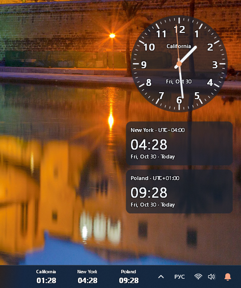
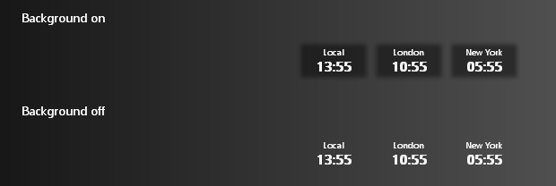
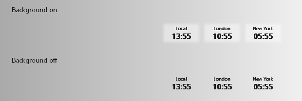
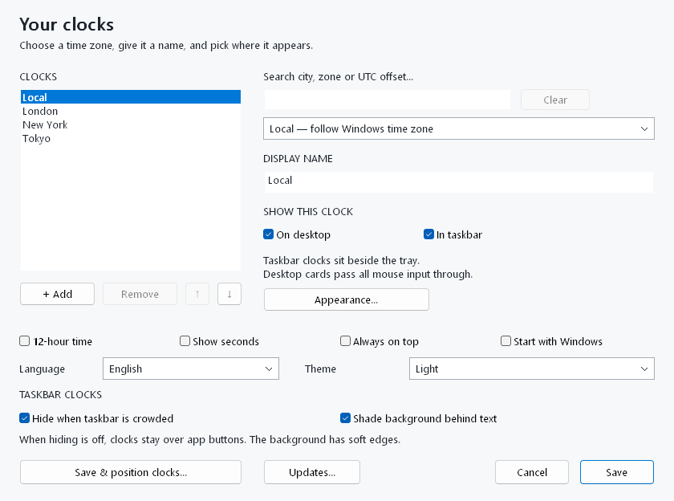
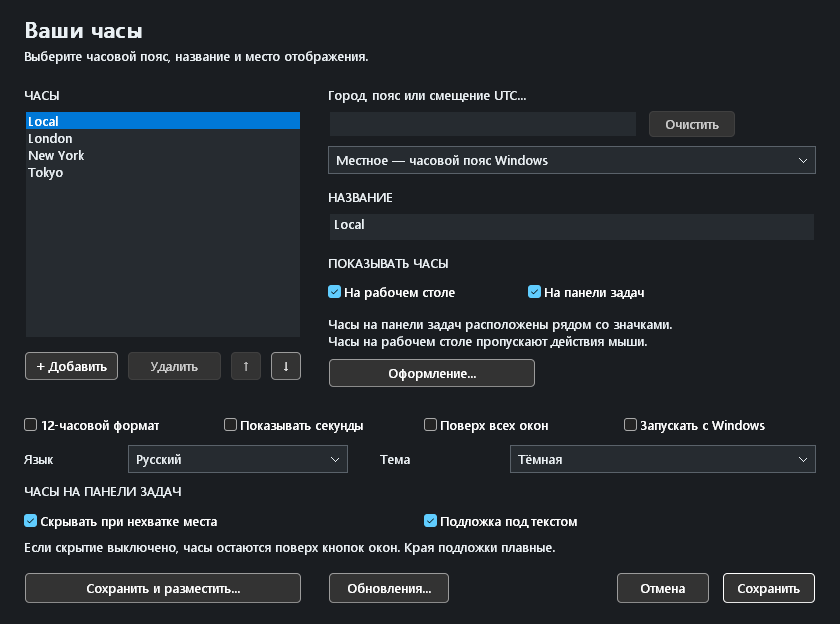
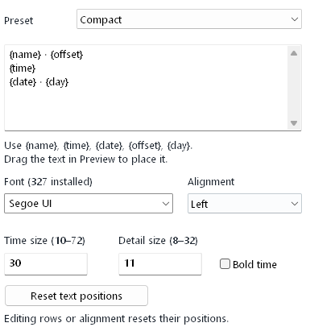
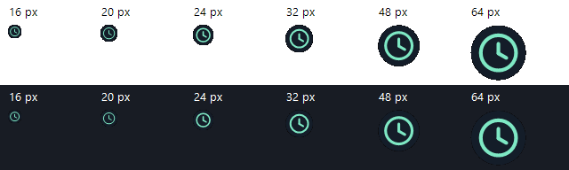

# World Clock

A lightweight, portable world clock for Windows, built with Rust. Mix mechanical dials and digital cards on your desktop, keep them visible with Win+D, and show a separate set of time zones in the taskbar — all in a single executable.

**[Download for Windows](https://github.com/siarheisinelnikau/world-clock/releases/latest)** · [User guide](docs/usage.md) · [Windows build](https://github.com/siarheisinelnikau/world-clock/actions/workflows/windows.yml)

## Features

- **Desktop clocks that stay out of the way.** Compact cards with no title bar, window frame, taskbar button, or Alt+Tab entry. Clicks and scrolling pass through them.
- **Visible with Show Desktop.** Desktop clocks stay above the wallpaper and icons when you press Win+D, while ordinary applications can still cover them.
- **Mechanical clock faces.** Switch each desktop clock between digital text and an analog dial. Customize Arabic or Roman numerals, minute marks, hand colors and widths, a smooth or ticking second hand, name, and date.
- **Time zones in the taskbar.** Transparent times beside the primary tray, in a row at the top/bottom or stacked on a left/right taskbar. Room for three or more clocks when space allows. Works independently of Windows' native clock visibility.
- **Separate clock sets.** Choose which clocks appear on the desktop, in the taskbar, or both. Add, rename, and reorder up to 12 clocks.
- **Searchable time zones.** Filter Windows' zone list by city, zone name, or UTC offset, then choose a matching result.
- **Updates from the app.** Check GitHub Releases from Settings or the tray, download a verified update, and restart with your settings preserved. Startup checks can be disabled.
- **A visual card editor.** Resize cards with the mouse and drag the time, labels, date, and UTC offset into place. Each clock can have its own style.
- **Fonts, colors, and transparency.** Use installed Windows fonts and custom content templates. Set separate colors and opacity for text, text outlines, card backgrounds, and borders.
- **Six interface languages and two themes.** English, Russian, French, German, Spanish, and Italian, with saved live language and Light/Dark controls in Settings.
- **One portable executable.** Offline operation, no installer or extra runtime. Settings live in your Windows user registry. Optional startup with Windows.
- **In-app updates.** Open **Updates…** from Settings or the tray menu to check, download, verify, and install a newer stable release. Startup checks run in the background by default; the Updates window has a persistent opt-out. Clock operation itself works offline.

## Example



Each desktop clock has its own appearance. Use a mechanical dial for one time zone and digital cards for the others; taskbar clocks keep their compact digital display.

## Get started

1. Download **WorldClock-vVERSION.exe** from the [latest release](https://github.com/siarheisinelnikau/world-clock/releases/latest), for example **WorldClock-v0.5.1.exe**.
2. Save it anywhere and run it on **64-bit Windows 10 or 11**.
3. Open **Settings** from the clock icon in the notification area. Check the tray overflow (`^`) if the icon is hidden. Running the executable again also opens Settings.
4. Add time zones and choose **On desktop** and **In taskbar** for each clock.
5. Open **Appearance…** to customize a clock. Choose **Digital** or **Mechanical (hands)** under **Clock type**, then **Use style** and **Save** in Settings.

To move the desktop clocks, choose **Save & position clocks…**. Drag them into place, then double-click to lock. Locked clocks let all mouse input pass through.

**Local** follows your Windows time zone. It can be hidden from both surfaces but cannot be removed. Time-zone conversion uses Windows' database, including daylight saving and fractional UTC offsets.

See the [user guide](docs/usage.md) for dial customization, templates, text positioning, startup, and taskbar behavior.

## Customize a mechanical clock

Select a clock in **Settings**, open **Appearance…**, and set **Clock type** to **Mechanical (hands)**. The **Dial** tab lets you choose Arabic or Roman numerals (or none), minute marks, name and date, hand width, and separate colors for the hour, minute, and second hands. Enable **Smooth sweep** for continuous second-hand movement, or disable it for one tick per second. The second hand has its own switch, independent of digital desktop seconds.

Use **Card** to resize the dial and adjust padding; **Auto** makes its canvas square. **Colors** controls the circular background, rim, numerals, marks, and opacity. A fully transparent background can leave just the hands and marks visible. **Content** sets the font and the name/date text size. Choose **Use style**, then **Save** to keep the design for that clock, or check **Apply this style to all clocks** to share it.

Desktop clocks remain visible when you press **Win+D**. They pass clicks through and stay below application windows unless **Always on top** is enabled.

## Taskbar notes

The extra clocks use the free gap between the primary taskbar's app buttons and tray. They draw transparent text, leave the native clock alone, and respect fullscreen and taskbar auto-hide. Left and right taskbars show the clocks vertically, with time text adjusted to fit their width.

Three slots need approximately 200 logical pixels of horizontal space or 140 logical pixels of vertical space. Clocks compact to fit more selected zones before rotating; four horizontal clocks need about 252 logical pixels, including spacing. When more zones still do not fit, groups switch every six seconds and overlap the final group to keep every slot filled. For example, four clocks sharing three slots alternate clocks 1–3 and 2–4. By default, clocks hide if app buttons leave too little room for the minimum group. In Settings, clear **Hide when taskbar is crowded** to keep clocks visible over app buttons. The overlay stays click-through and keeps clear of the system tray; fullscreen and taskbar auto-hide behavior still applies. Placement targets the primary Windows taskbar on any screen edge; modified taskbar shells may expose a different accessibility structure.

**Shade background behind text** independently enables a soft backdrop behind taskbar clocks: dark behind light text and light behind dark text. Its edges fade smoothly into the panel, and enabling, disabling, or changing the backdrop color uses a brief transition. Both taskbar options are enabled by default, apply to all taskbar clocks, and are stored when you choose **Save**.





These app-generated proofs use the actual taskbar text and backdrop renderer over a synthetic gradient; they are not screenshots of the Windows taskbar.

Your **In taskbar** selections remain independent of Windows' **Show time and date in the system tray** setting.

## Settings

Use **Language** and **Theme** along the bottom of Settings to switch between English, Русский, Français, Deutsch, Español, and Italiano, and between **Light** and **Dark**. Both preferences apply immediately and are saved even if you cancel unfinished clock edits. The interface language also changes date labels, relative days, tray commands, and update messages. Your clock names, time-zone IDs, and content templates stay intact. English and Light are the defaults for existing settings.

The theme covers Settings, Appearance, and Updates. Each desktop clock keeps its own user-selected colors and opacity; changing the interface theme never overwrites those designs. Windows-provided time-zone descriptions, common color dialogs, and technical error details follow Windows or their originating component.





These are the actual native Settings client rendered with fixture clocks; clock labels remain user data.



Open **Updates…** in Settings or the tray menu. The Updates window shows the installed version and offers **Check for updates** and, when a newer stable release exists, **Download and install**. Installation verifies SHA-256, saves your clocks and interface preferences, and restarts from the same executable path. **Check for updates on startup** is enabled by default and can be turned off; downloading and installing begin only when you choose the action. Versions before 0.4.1 need one manual download to gain updating. See the [update guide](docs/usage.md#updates) for details.

No administrator rights are needed. Normal use writes no files beside the executable. Settings are stored per Windows user at:

```text
HKEY_CURRENT_USER\Software\WorldClock
```

Copying the executable to another computer does not copy your settings. If startup is enabled and you move the executable, turn **Start with Windows** off and back on from its new location.

## Build from source

Requires Rust 1.95 or newer for `x86_64-pc-windows-msvc`, Visual Studio C++ Build Tools, and the Windows SDK. Keep the `rust-auto-updator` workspace beside this repository: the application uses `../rust-auto-updator/crates/rust-auto-updator` as its shared update engine. A standalone checkout or CI runner must provision that same sibling workspace before running Cargo. The dependency is currently local, not a published registry package.

```powershell
git clone https://github.com/siarheisinelnikau/world-clock.git
cd world-clock
.\build.ps1
```

Output: **dist/WorldClock-vVERSION.exe** (currently **WorldClock-v0.5.1.exe**), plus **dist/SHA256SUMS.txt**. The Microsoft C runtime, application icon, and DPI manifest are embedded; the executable uses standard Windows DLLs. The filename omits an architecture suffix because each release offers one executable for x64 Windows.
Rendering uses CPU rasterization and Windows GDI; there is no application OpenGL or Direct3D renderer. The native message loop sleeps between events. Hidden desktop clocks skip timer-driven rendering. Taskbar pixels update for changed time, geometry, color, visibility, or a new page when multiple clock groups are necessary; a single unchanged page is retained instead of being repainted every six seconds.

Run `target/release/world-clock.exe --diagnose-render target/render-diagnostic.json` for a finite app-owned check. It uses fixture clocks and a separate window/mutex, skips real settings/autostart writes, disables network updates and tray creation, and starts no taskbar accessibility tracker or system-taskbar overlay. The real desktop-clock painter and timer/message loop measure visible, hidden, minimized and restored windows for five seconds each after one second of settling, then save JSON and exit. Excessive CPU or raster activity ends the run early; no input is injected.

The [0.5.1 taskbar diagnostic](docs/diagnostics/taskbar-idle-v0.5.1.json) uses a deliberately crowded fixture with hiding disabled and toggles the backdrop twice through the production fade timer. All four settled samples recorded zero paints, rasterizations, and presents; process CPU stayed at or below 0.32% of one core. Startup, the two finite fades, and restore produced 26 frames in total. It shares the production painter, retained frame, and message/timer paths without attaching to Explorer. Run `WorldClock-v0.5.1.exe --diagnose-taskbar <output.json>` to repeat it. This does not measure real Explorer interactions, GPU timing, or input latency.

The [0.5.0 optimized diagnostic](docs/diagnostics/render-idle-v0.5.0.json) recorded zero paints, rasterizations, and GDI presents in the visible, hidden, minimized, and restored settled samples, each sampled for approximately five seconds. Process CPU was 0% of one core at `GetProcessTimes` resolution. The full diagnostic produced three deliberate startup/restore frames. This isolated clock-window check excludes background services, native Settings interaction, system-taskbar integration, GPU timing, and input latency.

The [2026-11-01 optimized diagnostic](docs/diagnostics/render-idle-2026-11-01.json) recorded zero paints, rasterizations and GDI present calls in all four settled samples, with 0% process CPU of one core at `GetProcessTimes` resolution. Startup and the application's own restore path produced two CPU frames and two present calls across the complete run. A prior diagnostic also observed a real minute change while hidden with zero rendering. This evidence covers isolated desktop-clock rendering; system-taskbar integration, background workers, input latency and GPU timings are separate checks.

`tools/verify-icons.ps1 -Executable target/release/world-clock.exe -Output target/icon-proof.png` loads the final executable's icon resources and draws native sizes on light and dark backgrounds without launching the application. This verifies packaged resources, not tray clicks, taskbar integration, or mixed-monitor behavior. Historical screenshots above show the clock and appearance editor. The current native Settings screenshots below are produced by an isolated render-save-exit mode; they verify client layout and colors, not OS tray interactions or idle performance. A current Updates screenshot and interactive mixed-monitor verification remain pending.



Checks:

```powershell
cargo fmt --check
cargo clippy --locked --all-targets -- -D warnings
cargo test --locked
```

GitHub Actions runs the same checks and builds the Windows executable. The release workflow publishes a fresh package version after its checks pass. See [Contributing](CONTRIBUTING.md) for development and release details.

## License

[MIT](LICENSE). Windows API bindings are provided by Microsoft's [windows-rs](https://github.com/microsoft/windows-rs).
