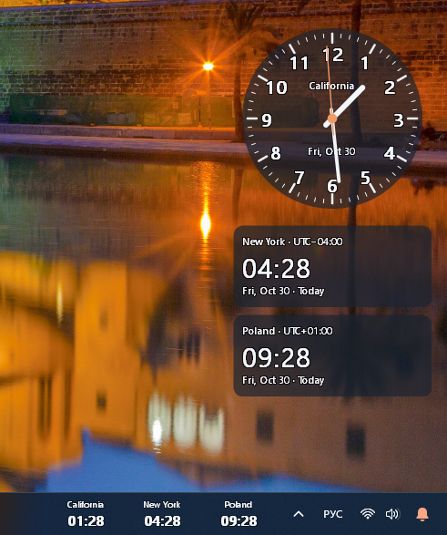
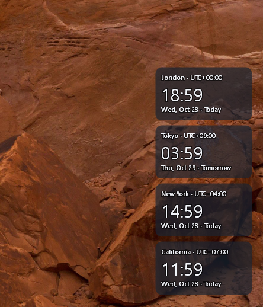
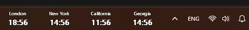
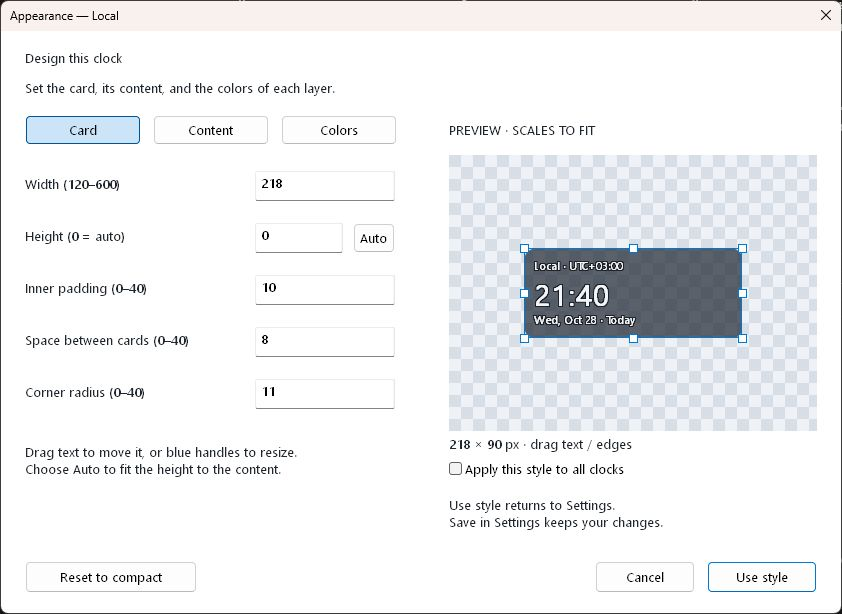
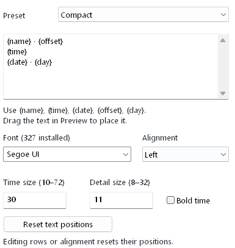
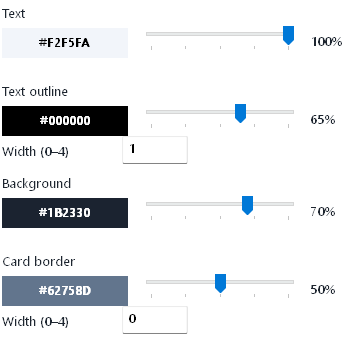

# World Clock

[](https://github.com/siarheisinelnikau/world-clock/actions/workflows/windows.yml)
[](LICENSE)

A lightweight, portable world clock for Windows, built with Rust. Mix mechanical dials and digital cards on your desktop, keep them visible with Win+D, and show a separate set of time zones in the taskbar — all in a single executable.

**[Download WorldClock.exe](https://github.com/siarheisinelnikau/world-clock/releases/latest/download/WorldClock.exe)** · [All releases](https://github.com/siarheisinelnikau/world-clock/releases) · [User guide](docs/usage.md)

## Features

- **Desktop clocks that stay out of the way.** Compact cards with no title bar, window frame, taskbar button, or Alt+Tab entry. Clicks and scrolling pass through them.
- **Visible with Show Desktop.** Desktop clocks stay above the wallpaper and icons when you press Win+D, while ordinary applications can still cover them.
- **Mechanical clock faces.** Switch each desktop clock between digital text and an analog dial. Customize Arabic or Roman numerals, minute marks, hand colors and widths, a smooth or ticking second hand, name, and date.
- **Time zones in the taskbar.** Transparent times beside the primary tray, in a row at the top/bottom or stacked on a left/right taskbar. Room for three or more clocks when space allows. Works independently of Windows' native clock visibility.
- **Separate clock sets.** Choose which clocks appear on the desktop, in the taskbar, or both. Add, rename, and reorder up to 12 clocks.
- **Searchable time zones.** Filter Windows' zone list by city, zone name, or UTC offset, then choose a matching result.
- **A visual card editor.** Resize cards with the mouse and drag the time, labels, date, and UTC offset into place. Each clock can have its own style.
- **Fonts, colors, and transparency.** Use installed Windows fonts and custom content templates. Set separate colors and opacity for text, text outlines, card backgrounds, and borders.
- **One portable executable.** English interface, offline operation, no installer or extra runtime. Settings live in your Windows user registry. Optional startup with Windows.

## Screenshots

Mechanical and digital desktop clocks, taskbar integration, and appearance settings. The checkerboard indicates transparency in the card preview.

### Mechanical and digital clocks together



Each desktop clock has its own appearance. Use a mechanical dial for one time zone and digital cards for the others; taskbar clocks keep their compact digital display.

### Digital desktop cards



### Time zones in the taskbar



### Resize cards visually



### Choose content and installed fonts



### Adjust each color and opacity separately



## Get started

1. Download **WorldClock.exe** from the [latest release](https://github.com/siarheisinelnikau/world-clock/releases/latest).
2. Save it anywhere and run it on **64-bit Windows 10 or 11**.
3. Open **Settings** from the clock icon in the notification area. Check the tray overflow (`^`) if the icon is hidden. Running the executable again also opens Settings.
4. Add time zones and choose **On desktop** and **In taskbar** for each clock.
5. Open **Appearance…** to customize a clock. Choose **Digital** or **Mechanical (hands)** under **Clock type**, then **Use style** and **Save** in Settings.

To move the desktop clocks, choose **Save & position clocks…**. Drag them into place, then double-click to lock. Locked clocks let all mouse input pass through.

**Local** follows your Windows time zone. It can be hidden from both surfaces but cannot be removed. Time-zone conversion uses Windows' database, including daylight saving and fractional UTC offsets.

See the [user guide](docs/usage.md) for dial customization, templates, text positioning, startup, and taskbar behavior.

## Customize a mechanical clock

Select a clock in **Settings**, open **Appearance…**, and set **Clock type** to **Mechanical (hands)**. The **Dial** tab lets you choose Arabic or Roman numerals (or none), minute marks, name and date, hand width, and separate colors for the hour, minute, and second hands. Enable **Smooth sweep** for continuous second-hand movement, or disable it for one tick per second. The second hand has its own switch, independent of digital desktop seconds.

Use **Card** to resize the dial and adjust padding; **Auto** makes its canvas square. **Colors** controls the circular background, rim, numerals, marks, and opacity. A fully transparent background can leave just the hands and marks visible. **Content** sets the font and the name/date text size. Choose **Use style**, then **Save** to keep the design for that clock, or check **Apply this style to all clocks** to share it.

Desktop clocks remain visible when you press **Win+D**. They pass clicks through and stay below application windows unless **Always on top** is enabled.

## Taskbar notes

The extra clocks use the free gap between the primary taskbar's app buttons and tray. They draw transparent text, leave the native clock alone, and respect fullscreen and taskbar auto-hide. Left and right taskbars show the clocks vertically, with time text adjusted to fit their width.

Three slots need approximately 200 logical pixels of horizontal space or 140 logical pixels of vertical space. Additional zones rotate in groups when necessary. If the taskbar is too full, the clocks hide to avoid covering buttons or tray controls. Placement targets the primary Windows taskbar on any screen edge; modified taskbar shells may expose a different accessibility structure.

Your **In taskbar** selections remain independent of Windows' **Show time and date in the system tray** setting.

## Settings

No administrator rights are needed. Normal use writes no files beside the executable. Settings are stored per Windows user at:

```text
HKEY_CURRENT_USER\Software\WorldClock
```

Copying the executable to another computer does not copy your settings. If startup is enabled and you move the executable, turn **Start with Windows** off and back on from its new location.

## Build from source

Requires stable Rust for `x86_64-pc-windows-msvc`, Visual Studio C++ Build Tools, and the Windows SDK.

```powershell
git clone https://github.com/siarheisinelnikau/world-clock.git
cd world-clock
.\build.ps1
```

Output: **dist/WorldClock.exe**, plus **dist/SHA256SUMS.txt**. The Microsoft C runtime, application icon, and DPI manifest are embedded; the executable uses standard Windows DLLs.

Checks:

```powershell
cargo fmt --check
cargo clippy --locked --all-targets -- -D warnings
cargo test --locked
```

GitHub Actions runs the same checks and builds the Windows executable. A new package version on `main` is published automatically after the checks pass. See [Contributing](CONTRIBUTING.md) for development and release details.

## License

[MIT](LICENSE). Windows API bindings are provided by Microsoft's [windows-rs](https://github.com/microsoft/windows-rs).
